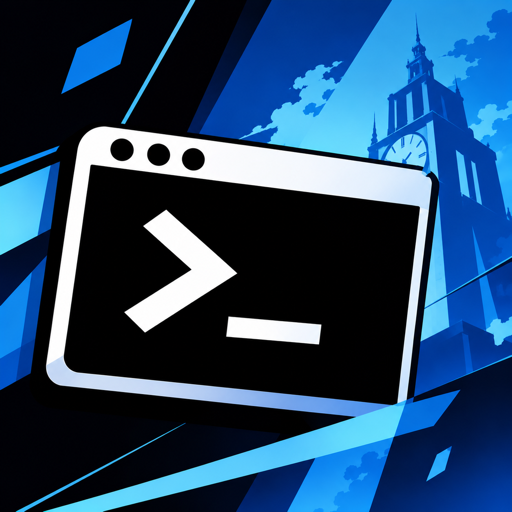
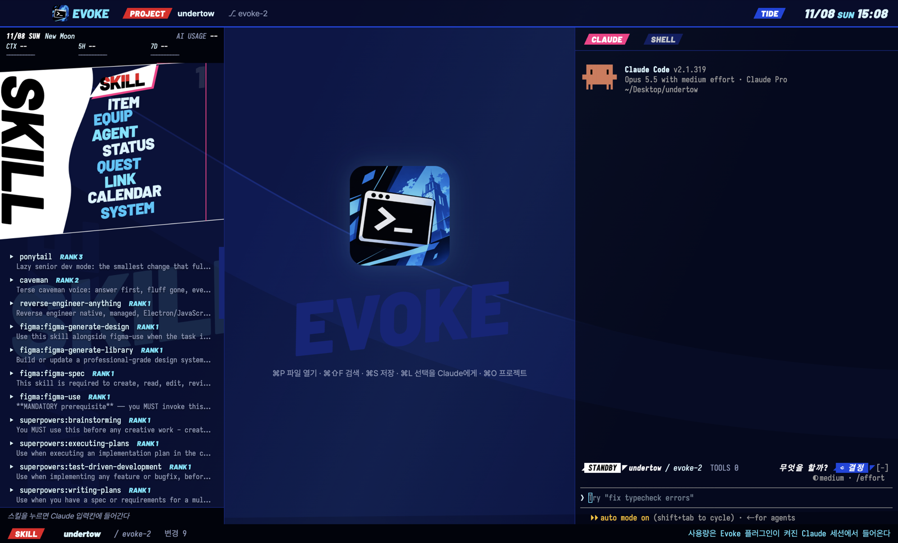

# Evoke



[English](README.md) | [한국어](README.ko.md) | **日本語**

[Claude Code](https://claude.com/claude-code) を中心に据えたデスクトップのコードエディタです。傾いたゲームメニューのデザインをまとっています。ファイル、エディタ、git、シェル、Claude Code がひとつのウィンドウに並び、VS Code や Cursor で拡張機能を入れていた機能が最初から入っています。



## ダウンロード

[Releases](https://github.com/jinjwon/undertow/releases/latest) から入手します。

| システム | ファイル | インストール |
| --- | --- | --- |
| macOS (Apple シリコン) | `Evoke-<バージョン>-arm64.dmg` | 開いて Evoke をアプリケーションフォルダへドラッグ |
| Windows (x64) | `Evoke-Setup-<バージョン>.exe` | 実行するとスタートメニューとデスクトップにショートカットができる |
| Windows (インストール不要) | `Evoke-<バージョン>-win-x64.zip` | どこかに展開して `Evoke.exe` を実行 |

[Claude Code](https://docs.claude.com/ja/docs/claude-code) をインストールしてログインしておく必要があります。ほかには何もいりません。

署名していないビルドです。初回だけ、macOS では Evoke を右クリックして「開く」、Windows では「詳細情報 → 実行」を選びます。

## ウィンドウの中身

- **MENU パネル (左):** ターミナル版パネルの 9 つのメニューを、アートとカットインごと収めました。傾いた名前を押します。SKILL (スキルを Claude の入力欄へ)、ITEM (ファイル)、EQUIP (MCP サーバーとプラグイン)、AGENT (過去のセッションを再開)、STATUS (変更ファイルを最後のコミットと比較)、QUEST (残りの TODO)、LINK (プロジェクト)、CALENDAR (Claude と話した日)、SYSTEM (テーマ・言語・ショートカット)。上の HUD は日付、月齢、コンテキスト、5 時間・7 日の使用量とリセットまでの時間、セッション費用を表示し、85% で通知します。
- **エディタ (中央):** Monaco。TS/JS・JSON・CSS・HTML の補完、エラー表示、整形。保存時に整形、括弧の色分け、HTML タグの対応名の同時変更、差分表示、ミニマップ。
- **プレビュータブ:** 1 回クリックでプレビュー (斜体のタブ、次のファイルで置き換わる)、ダブルクリックか編集で固定。画像は画像として開きます。
- **ファイルバッジ** (TS, JS, {}, MD, IMG…) がツリー、タブ、クイックオープンに付きます。
- **CLAUDE / SHELL (右):** プロジェクトごとに Claude Code セッションとシェルをひとつずつ。プロジェクトを切り替えても続きます。
- **VS Code のように開始:** 起動するとフォルダを開くと最近のプロジェクトが出ます。
- **テーマ 2 種類**、テーマごとにロゴが違います。**TIDE** は太い斜線の白と青のゲームメニュー。**REBEL** はブラッドレッド、ピッチブラック、スタークホワイトの 3 色だけを使うプロンプトエンジニアリング向けテーマです。パネルの角は斜めに切り取られ、境目にハーフトーンのドット、フォルダと通知には怪盗の仮面。プロンプトの `{{変数}}` は雑誌を切り貼りした脅迫状のように 1 文字ずつ強調されます。
- **UI 編集モード:** 上部バーの `UI` を押すと、パネルとウィジェットをドラッグ、リサイズ、入れ替えできます。レイアウトとプリセットは再起動後も保持されます。
- **English, 한국어, 日本語:** 設定 (右上の ⚙) で選びます。既定はシステムの言語です。

### ショートカット

Windows では `⌘` の代わりに `Ctrl`。

| キー | 動作 |
| --- | --- |
| `⌘P` | 名前でファイルを開く |
| `⌘⇧F` | プロジェクトを検索 |
| `⌘S` | 整形して保存 |
| `⌘L` | 選択範囲を `@file#Lx-y` として Claude へ |
| `⌘O` | プロジェクト (`1`–`9` または Enter) |

## 使用量 HUD

数値は CLAUDE パネル内で動く Evoke プラグインから届きます。Claude Code の入力欄で一度だけインストールします。

```
/plugin install evoke --marketplace jinjwon/undertow
```

## 自分でビルドする

```sh
git clone https://github.com/jinjwon/undertow.git
cd undertow/desktop && npm install && npm start
npm run dist:mac        # release/Evoke-<バージョン>-arm64.dmg
npm run dist:win        # Windows インストーラー (Windows 上で)
```

## アンインストール

**アプリ:** アプリケーションフォルダから Evoke を削除するか、Windows の設定 → アプリから削除します。

**プラグイン:** `/plugin uninstall evoke` を実行します。

## クレジットとプライバシー

Evoke 自身は AI やネットワークへの要求を送りません。CLAUDE パネルの Claude Code は他の場所と同じようにプランを使います。読み書きするファイルは [SECURITY.md](SECURITY.md) を参照してください。

## ライセンスと注意

[MIT](LICENSE)。アートの書体は [Barlow](https://github.com/jpt/barlow) ([OFL](plugins/evoke/tools/fonts/OFL.txt)) です。

Evoke は Persona 3 Reload (TIDE) と Persona 5 (REBEL) のメニューデザインに着想を得た非公式のファンプロジェクトです。ATLUS や SEGA とは関係がなく、承認も受けておらず、ゲームのアセットは含みません。変更点は [CHANGELOG.md](CHANGELOG.md) にあります。
