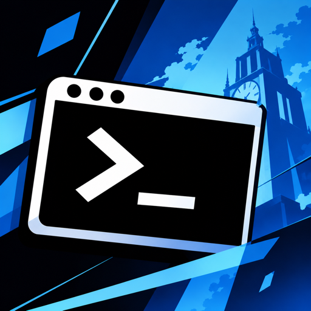
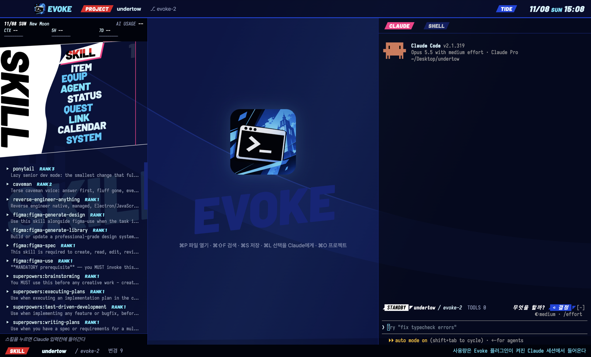

# Evoke



[English](README.md) | **한국어** | [日本語](README.ja.md)

[Claude Code](https://claude.com/claude-code)와 [Codex](https://developers.openai.com/codex/cli)를 중심에 둔 데스크톱 코드 에디터입니다. 기울어진 게임 메뉴 디자인을 입혔습니다. 파일, 에디터, git, 셸, Claude Code가 한 창에 있고, VS Code나 Cursor에서 확장 프로그램을 깔아야 했던 기능이 기본으로 들어 있습니다.



## 다운로드

[Releases](https://github.com/jinjwon/undertow/releases/latest)에서 받습니다.

| 시스템 | 파일 | 설치 |
| --- | --- | --- |
| macOS (Apple 실리콘) | `Evoke-<버전>-arm64.dmg` | 열어서 Evoke를 응용 프로그램 폴더로 끌어 놓습니다 |
| Windows (x64) | `Evoke-Setup-<버전>.exe` | 실행하면 시작 메뉴와 바탕화면 바로가기가 생깁니다 |
| Windows, 설치 없이 | `Evoke-<버전>-win-x64.zip` | 아무 곳에나 압축을 풀고 `Evoke.exe` 실행 |

[Claude Code](https://docs.claude.com/ko/docs/claude-code)나 [Codex](https://developers.openai.com/codex/cli)가 설치되어 로그인되어 있어야 합니다. 둘 중 하나면 됩니다. 앱이 어느 것을 쓸지는 설정에서 고릅니다.

서명하지 않은 빌드입니다. 처음 한 번, macOS에서는 Evoke를 우클릭해 열기를 고르고, Windows에서는 추가 정보 → 실행을 누릅니다.

## 창 구성

- **MENU 패널 (왼쪽):** 터미널 패널의 메뉴 아홉 개가 아트와 컷인 그대로 들어 있습니다. 기울어진 이름을 누릅니다.

  | 메뉴 | 내용 |
  | --- | --- |
  | SKILL | 스킬, 많이 쓴 순서. 누르면 Claude 입력칸에 들어갑니다 |
  | ITEM | 프로젝트 파일 |
  | EQUIP | Claude Code가 이 프로젝트에 가져가는 MCP 서버와 플러그인 |
  | AGENT | 이 프로젝트의 지난 Claude Code 대화. 누르면 이어서 합니다 |
  | STATUS | 바뀐 파일. 누르면 마지막 커밋과 비교합니다 |
  | QUEST | 프로젝트에 남은 `TODO` |
  | LINK | 신뢰한 프로젝트(최근에 쓴 순서)와 `~/.ssh/config`의 서버 |
  | CALENDAR | 이번 달, Claude와 대화한 날 표시 |
  | SYSTEM | 테마와 단축키 |

  위쪽 HUD는 날짜, 달, 컨텍스트, 5시간·7일 사용량과 초기화까지 남은 시간, 세션 비용을 보여 줍니다. 85%를 넘으면 알림이 뜹니다.
- **에디터 (가운데):** Monaco. TS/JS, JSON, CSS, HTML 자동완성·오류 표시·정렬, 괄호 색과 가이드, HTML 태그 짝 이름 같이 바꾸기, diff 보기.
- **CLAUDE / CODEX / SHELL (오른쪽):** 프로젝트마다 Claude Code 세션, Codex 세션, 셸이 하나씩. 프로젝트를 바꿔도 유지됩니다. Codex와 셸은 탭을 처음 열 때 시작합니다.
- **코딩 에이전트:** 설정(⚙) → 일반에서 Claude Code와 Codex, Claude Code만, Codex만 중에 고릅니다. 끈 에이전트는 탭이 없고 실행되지도 않습니다. Codex만 쓰면 Codex가 신뢰한 프로젝트가 프로젝트 목록에 나옵니다. 지난 대화, 사용량 HUD, 스킬 목록은 Claude Code에서 옵니다.
- **미리보기:** PDF, 영상, 소리 파일은 미리보기 탭으로 열립니다. HTML이나 Markdown 파일에서는 탭 줄 끝의 `LIVE`를 누르면 그 페이지가 옆 탭에 열리고, 프로젝트의 파일이 바뀔 때마다 새로 고쳐집니다. `↗`는 같은 페이지를 브라우저에서 엽니다. Word, Excel, PowerPoint 파일은 미리보기가 없습니다.
- **서버:** LINK에 `~/.ssh/config`의 호스트가 나옵니다. 누르면 `ssh` 터미널이 별도 탭으로 열립니다. 서버의 터미널이며, 서버 파일이 에디터에 열리지는 않습니다.
- **크기 조절과 접기:** 패널 사이 경계를 끌면 크기가 바뀌고, 더블클릭하면 원래대로 돌아갑니다. `⌘B`는 사이드바, `⌘J`는 터미널을 접습니다. 상단 바의 `◧` `◨`도 같습니다. 접으면 에디터가 그 자리를 쓰고, 접힌 터미널은 계속 실행됩니다.
- **테마 두 가지,** 테마마다 로고가 다릅니다. **TIDE**는 굵은 사선의 흰색·파란색 게임 메뉴입니다. **REBEL**은 핏빛 레드, 칠흑 같은 블랙, 쨍한 화이트 세 가지 색만 쓰는 프롬프트 엔지니어링용 테마입니다. 패널 모서리는 사선으로 잘려 있고, 경계에는 하프톤 도트가 들어가며, 폴더와 알림에는 괴도 가면이 붙습니다. 프롬프트의 `{{변수}}`는 잡지를 오려 붙인 납치범 편지처럼 글자마다 다르게 강조됩니다.
- **UI 편집 모드:** 상단 바의 `UI`를 누르면 패널과 위젯을 드래그, 리사이즈, 자리 교환할 수 있습니다. 레이아웃과 프리셋은 재실행해도 유지됩니다.
- **VS Code처럼 시작:** 창을 열면 폴더 열기와 최근 프로젝트가 나옵니다.
- **미리보기 탭:** 한 번 누르면 미리보기(기울어진 탭, 다음 파일로 바뀜), 두 번 누르거나 고치면 고정됩니다. 이미지는 그림으로 열립니다. 미니맵이 파일 전체를 보여 줍니다.
- **파일 배지** (TS, JS, {}, MD, IMG…)가 트리, 탭, 빠른 열기에 붙습니다.
- **English, 한국어, 日本語:** 설정(오른쪽 위 ⚙)에서 고릅니다. 기본값은 시스템 언어입니다.

### 단축키

Windows는 `⌘` 대신 `Ctrl`입니다.

| 키 | 동작 |
| --- | --- |
| `⌘P` | 이름으로 파일 열기 |
| `⌘⇧F` | 프로젝트 검색 |
| `⌘S` | 정렬한 뒤 저장 |
| `⌘L` | 선택 영역을 `@file#Lx-y`로 Claude에게 전달. CODEX 탭이 보일 때는 Codex에게 |
| `⌘O` | 프로젝트 (`1`–`9` 또는 Enter) |
| `⌘B` | 사이드바 접기/펴기 |
| `⌘J` | 터미널 접기/펴기 |

저장하지 않은 변경이 없으면, Claude가 고친 파일은 탭에 다시 읽힙니다.

## 사용량 HUD

Claude Code는 사용량을 플러그인에게 알려 주므로, 숫자는 CLAUDE 패널 안에서 도는 Evoke 플러그인에서 옵니다. Claude Code 입력칸에서 한 번 설치합니다.

```
/plugin install evoke --marketplace jinjwon/undertow
```

플러그인은 어느 터미널에서나 따로도 동작합니다. `/menu`는 패널, `/projects`는 프로젝트 선택, `/skillbook`은 스킬 목록입니다. 이미지를 그리지 못하는 터미널에서는 일반 텍스트 행으로 나옵니다.

## 디자인

### 참고한 것

| 출처 | 가져온 것 | Evoke에서 쓰인 곳 |
| --- | --- | --- |
| Persona 5 | 레드·블랙·화이트 대비, 크고 기울어진 글자, 오려 붙인 종이 같은 판, 고르면 커지고 자리를 옮기는 이름 | 선택된 메뉴 하나: 흰 판, 검정 글자를 가르는 빨간 사선, 핑크 그림자. 이웃 이름은 위아래로 비켜납니다. 빨강은 선택과 경고에만 씁니다. REBEL 테마 전체 |
| Persona 3 Reload | 시안·블루·화이트, 물과 유리, 사선으로 자른 패널, 커서에서 내용으로 이어지는 선, 하단 조작 안내 | 패널 바탕(물 셰이더가 비치는 투명 배경), 선택되지 않은 이름의 시안 세 단계, 사선 HUD, 커서에서 내용으로 내려오는 선, 하단 `Command` 줄. TIDE 테마 전체 |
| VS Code | 액티비티 바 → 사이드 바 → 에디터 → 패널 → 상태 표시줄의 층, 빠른 열기, 미리보기 탭 | 메뉴 아홉 개가 액티비티 바, 그 아래 내용이 사이드 바, HUD와 입력칸 위 띠가 상태 표시줄 역할을 합니다. 앱의 `⌘P` `⌘⇧F` `⌘B` `⌘J`는 VS Code와 같은 키입니다 |
| Cursor | 에디터 옆 AI 패널, 선택 영역을 채팅으로 보내기 | 오른쪽 CLAUDE / CODEX 패널, `⌘L` |

두 게임을 섞지 않고 역할을 나눴습니다. 바탕과 정보는 Persona 3 Reload의 차가운 색으로, 지금 고른 것 하나만 Persona 5의 빨강과 흰 판으로 그립니다.

### 메뉴와 패널의 원칙

- **위에서 아래로 한 방향:** HUD(상태) → 메뉴 아홉 개(고르기) → 고른 메뉴의 내용 → 하단 안내(할 수 있는 일과 키).
- **아이콘:** 메뉴마다 이름 앞에 하나씩 있습니다. 불꽃(SKILL), 파일(ITEM), 플러그(EQUIP), 일행(AGENT), 게이지(STATUS), 깃발(QUEST), 고리(LINK), 달(CALENDAR), 톱니(SYSTEM). 이름과 같은 색이고, 선택되면 빨강이 됩니다.
- **상태 색:** 빨강은 선택, 80% 이상 게이지, 오류. 시안은 누를 수 있는 것과 보조 정보. 회색은 쓰지 않는 것. 핑크는 커서의 가장자리와 횟수.
- **섹션:** 패널은 VS Code 사이드 바처럼 띠 머리글이 붙은 섹션으로 나뉩니다. MENU, 고른 메뉴의 내용(스킬은 플러그인마다 한 섹션), COMMAND 순서이고, 머리글 오른쪽에 개수가 붙습니다.
- **그림이 없는 터미널:** Windows Terminal처럼 이미지를 못 그리는 곳에서도 같은 모양을 글자로 그립니다. 이름은 아트처럼 어긋난 세로 열에 서고, 고른 이름은 흰 판에 검정 글자, 핑크 모서리입니다.
- **실제 데이터만:** 기록이 없는 메뉴는 "아직 기록이 없어요"만 보여 줍니다.
- **그림과 조작을 구분:** 터미널에서 기울어진 이름은 그림 한 장이라 누를 수 없습니다. 누를 수 있는 것은 오른쪽 가장자리의 `1`–`9`와 하단 키 줄입니다.
- **움직임:** 메뉴가 바뀔 때만 그림 네 장을 24ms 간격으로 바꿉니다. 그 밖에는 타이머가 돌지 않습니다.

### 터미널 패널의 키

수식 키가 없어 macOS, Windows, Linux에서 같습니다. 패널이 키보드를 잡고 있을 때만 동작하며, 하단 줄에 `KEYS ON`이 보입니다. 아니면 `ctrl+x tab`을 누르거나 패널을 클릭합니다.

| 분류 | 키 | 동작 |
| --- | --- | --- |
| 메뉴 이동 | `j` / `k` | 다음 / 이전 메뉴 |
| 메뉴 선택 | `1`–`9` | 그 메뉴를 고르고 명령을 입력칸에 채움 |
| 실행 | `e`, 이어서 Enter | 고른 메뉴의 명령을 입력칸에 채우고 실행 |
| 쪽 넘김 | `n` / `b` | SKILL의 다음 쪽 / 이전 쪽 |
| 패널 전환 | `p` / `s` | 프로젝트 선택 / 스킬북 |
| 뒤로 | `Esc` | 프로젝트 선택이나 스킬북을 닫음 |
| 명령 | `/menu` `/projects` `/skillbook` | 입력칸에서 패널을 엶 |

### 알려진 한계

- 터미널이 110열보다 좁으면 Claude Code가 패널을 입력칸 위에 놓습니다. 이때는 그림 없이 일반 행으로 그리고, 키 줄을 내용 위에 둬서 잘려도 조작은 남습니다.
- 창이 낮으면 그림이 비율을 지키며 통째로 작아져 오른쪽에 물이 남습니다.
- 그림의 열 수는 Iosevka 14의 셀 비율(너비 ÷ 높이 = 0.4)로 계산합니다. 다른 글꼴이면 `EVOKE_CELL=0.5`처럼 그 글꼴의 비율을 환경 변수로 줍니다.

### 출처

- Persona 5 Royal: <https://persona.atlus.com/p5r/>
- Persona 3 Reload: <https://persona.atlus.com/p3r/>
- VS Code, user interface: <https://code.visualstudio.com/docs/editing/getting-started/userinterface>
- VS Code, personalize: <https://code.visualstudio.com/docs/getstarted/personalize-vscode>
- VS Code, keyboard shortcuts: <https://code.visualstudio.com/docs/configure/keybindings>
- VS Code, default keybindings: <https://code.visualstudio.com/docs/reference/default-keybindings>
- Cursor, keyboard shortcuts: <https://docs.cursor.com/advanced/keyboard-shortcuts>

## 직접 빌드

```sh
git clone https://github.com/jinjwon/undertow.git
cd undertow/desktop && npm install && npm start
npm run dist:mac        # release/Evoke-<버전>-arm64.dmg
npm run dist:win        # Windows 설치 파일, Windows에서
```

`v*` 태그를 푸시하면 GitHub Actions가 두 설치 파일을 만들어 릴리스에 붙입니다.

테마 하나는 `desktop/src/themes.ts`의 항목 하나와 `desktop/src/style.css`의 블록 하나입니다.

## 삭제

**앱:** 응용 프로그램 폴더에서 Evoke를 지우거나, Windows 설정 → 앱에서 제거합니다.

**플러그인:** `/plugin uninstall evoke`를 실행하거나, 셸에서 `claude plugin uninstall evoke`를 실행합니다.

## 크레딧과 개인정보

Evoke는 자체적으로 AI나 네트워크 요청을 보내지 않습니다. CLAUDE 패널의 Claude Code는 다른 곳에서와 똑같이 요금제를 씁니다. 프롬프트를 보내기 전에는 모델로 아무것도 전송되지 않습니다. 앱이 읽고 쓰는 파일은 [SECURITY.md](SECURITY.md)를 보세요.

## 라이선스와 고지

[MIT](LICENSE). 아트 서체는 [Barlow](https://github.com/jpt/barlow) ([OFL](plugins/evoke/tools/fonts/OFL.txt))입니다.

Evoke는 Persona 3 Reload(TIDE)와 Persona 5(REBEL)의 메뉴 디자인에서 영감을 받은 비공식 팬 프로젝트입니다. ATLUS나 SEGA와 관련이 없고 승인받지 않았으며, 게임 에셋을 포함하지 않습니다. 취약점 신고는 [SECURITY.md](SECURITY.md)를 보세요. 변경 사항은 [CHANGELOG.md](CHANGELOG.md)에 있습니다.
