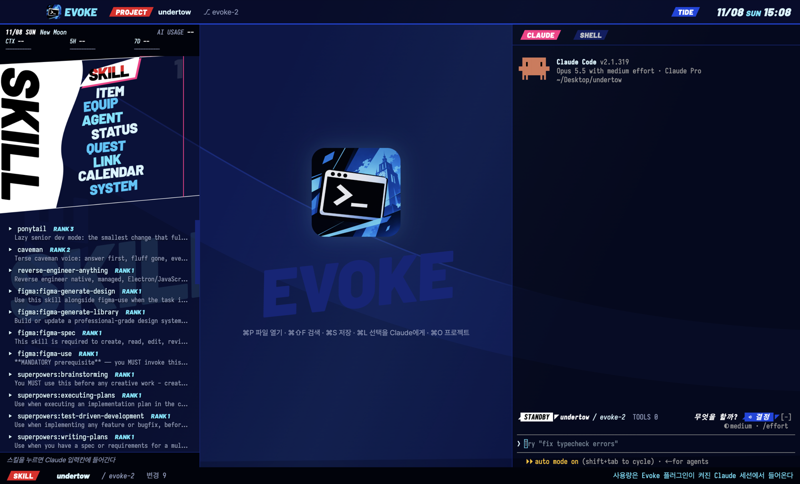

# Undertow


**English** | [한국어](README.ko.md)

An underwater, slanted, game-menu interface for [Claude Code](https://claude.com/claude-code) in [Ghostty](https://ghostty.org). The water runs behind both the transcript and the menu, so the terminal reads as one surface.



## Features

- **Nine menus:** each has its own composition and kind of content. Tool calls light up their menu.
- **AI usage HUD:** context, 5-hour and 7-day gauges with reset countdowns, plus session cost. A toast warns at 85%.
- **Skills:** grouped and paged, most used first. `/skillbook` shows them all.
- **Project switcher:** `p` or `/projects` lists your trusted Claude Code projects, most recently used first. Press `1` or Enter to open the top one in a new window.
- **Status band:** session state, project, branch and tool count above the prompt.

## Install

Requires Claude Code. The plugin runs on macOS and Windows; the full look needs macOS and Ghostty, which has no Windows build. For the full look, also install Ghostty, [Iosevka](https://github.com/be5invis/Iosevka) and [Pretendard](https://github.com/orioncactus/pretendard).

### Ghostty (full look)

```sh
git clone https://github.com/jinjwon/undertow.git
undertow/ghostty/install.sh
```

Restart Ghostty. The clone's path may contain spaces, but not quotes, `$`, backticks or backslashes. The installer writes `~/.config/ghostty/undertow.conf` and adds one include line to `~/.config/ghostty/config`.

**Every new Ghostty window then starts Claude Code with the menu.** See [Settings](#settings) to keep a plain shell instead.

### Plugin only

Run this at the Claude Code prompt, then `/menu`. Terminals that cannot draw images get plain rows instead of the art.

```
/plugin install undertow --marketplace jinjwon/undertow
```

### Windows

Use the plugin install above. The menu, HUD, skills and commands appear as plain rows, without the water or art. `/projects` opens projects in Windows Terminal (`wt`).

Windows support is checked by automated tests that simulate Windows. It has not yet been run on a Windows machine, so please report anything that breaks.

### macOS Terminal

```sh
undertow/terminal/install.sh            # add --default to make it the default profile
```

Terminal has no animated water or art, so the menu uses plain rows. This profile also starts Claude Code.

## Settings

| To change | Do this |
| --- | --- |
| Keep a plain shell in Ghostty | Delete the `command` line from `~/.config/ghostty/undertow.conf` |
| Window size | `window-width` and `window-height` in `undertow.conf`. The docked menu needs at least 110 columns |
| Font | `font-family` and `font-size` in `undertow.conf`. The art lines up with Iosevka at size 14 |
| Add your own image | Put a transparent PNG you have the rights to at `plugins/undertow/hero.png`, then run `plugins/undertow/tools/render.sh` (needs Google Chrome). `hero.png` is git-ignored |

## Commands and shortcuts

| Command | Does |
| --- | --- |
| `/menu` | Open the menu pane |
| `/projects` | Pick a project |
| `/skillbook` | Browse skills by group and pick one |

Give the pane the keyboard with a click or `ctrl+x tab`, then:

| Key | Does |
| --- | --- |
| `1`-`9` | Choose a menu and fill the prompt with its command |
| `j` / `k` | Next / previous menu |
| `e` | Fill the prompt with the current menu's command |
| `n` / `b` | Next / previous page of skills |
| `p` | Open the project picker |
| `s` | Fill the prompt with `/skillbook` |

To click a menu, use its number at the right edge: the slanted names are part of the picture.

## Uninstall and restore

**Ghostty:** delete the `config-file = undertow.conf` line from `~/.config/ghostty/config`, delete `~/.config/ghostty/undertow.conf`, and restart Ghostty.

**Plugin:** run `/plugin uninstall undertow`, or `claude plugin uninstall undertow` in a shell.

**Terminal:** in Terminal > Settings > Profiles, delete the Undertow profile. If you used `--default`, choose another default first.

Delete the cloned folder last: the Ghostty and Terminal setups read their files from it.

## How credits are used

Undertow makes no AI requests of its own. Its code has no model, agent or network calls: the HUD only draws the usage figures Claude Code already holds. Measured with Claude Code 2.1.319 on macOS:

| Setup | AI requests | Result |
| --- | --- | --- |
| Ghostty with the Undertow look and a plain shell (no `command` line) | None | No Claude process and no TCP connections in a 12-second sample |
| zsh | None | Undertow adds nothing to your shell. It loads only inside Claude Code |
| Claude Code + Undertow, opened with `/menu`, no prompt sent | No model reply, session cost $0 | One `quota_check` request at start, the same as without Undertow |
| Claude Code + Undertow, one prompt | Your prompt only | First request 29,175 context tokens with and without Undertow, in 3 of 3 pairs |

The `quota_check` request belongs to Claude Code and happens on every start. We have not verified whether it counts against your plan.

- **Using Claude Code still uses your plan.** Ghostty's `command` line starts Claude Code, but nothing is sent to a model until you send a prompt.
- **Not measured:** the `/menu` confirmation line, which is short text in the transcript that Claude Code can include in later requests.
- **Other skills are separate.** Installing a skill is not the same as running it. For example, invoking the Ponytail skill added 1,557 context tokens to that request.

## License and notice

[MIT](LICENSE). The art's typeface is [Barlow](https://github.com/jpt/barlow) ([OFL](plugins/undertow/tools/fonts/OFL.txt)).

Undertow is an unofficial fan project inspired by the menu design of Persona 3 Reload. It is not affiliated with or endorsed by ATLUS or SEGA, and it contains no game assets. To report a vulnerability, see [SECURITY.md](SECURITY.md). Changes are listed in [CHANGELOG.md](CHANGELOG.md).
